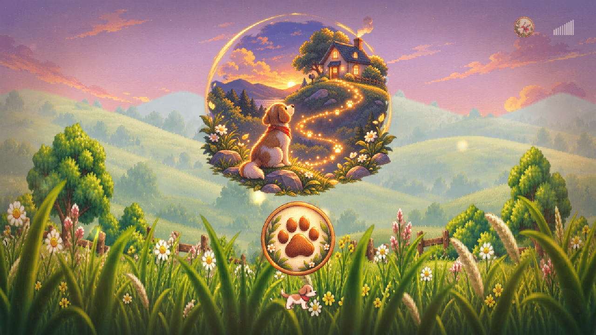

# ToTheHome

> 죽은 강아지가 주인의 냄새를 쫓아 집으로 돌아가는 꿈 이야기.
> 웹/모바일 겸용 2D 사이드스크롤 플랫포머. **대사도 문자도 없다.**

## 플레이

- **브라우저에서 바로**: https://parkrye.github.io/WebProject_ToTheHome/ (PC · 모바일)
- **내려받아 오프라인으로 (Windows)**: [Releases](../../releases)에서 `ToTheHome-<버전>-windows.zip`을 받아 압축을 풀고 `play.bat` 실행. 브라우저가 열리고, 검은 창을 닫으면 종료

## 조작

| 입력 | 동작 |
|---|---|
| `←` `→` / `A` `D` | 이동 |
| `Space` / `↑` / `W` | 점프 (누른 시간만큼 높이 조절) |
| `Shift` | 도움닫기 (한 방향을 0.45초 유지해도 자동 진입) |
| `↓` / `S` | 아래쪽 보기 |
| `↓` + 점프 | 딛고 선 발판을 통과해 내려가기 |
| `E` / `Enter` | 상호작용 (세이브 포인트 · 도착 지점) · 쥐고 있으면 냄새 맡기 |
| `Esc` | 일시정지 |

모바일에서는 좌하단 방향 버튼과 우하단 점프 · 상호작용 버튼이 나타난다. 소리 크기는 일시정지 패널과 타이틀 오른쪽 위 단추에서 맞춘다.

## 구성

프롤로그(4컷) → 스테이지 1 도시 → 2 해안가 → 3 산 → 4 들판 → 엔딩

| 스테이지 | 컨셉 |
|---|---|
| 1 도시 | 아직 깨지 않은 도시에서 길을 찾는 첫 여정. 기초 조작을 배운다 |
| 2 해안가 | 주인이 차로 오가던 길. 파도와 좁은 도로 |
| 3 산 | 집은 산 너머. 가장 어렵다 |
| 4 들판 | 함께 살던 곳. 위험이 없다 |

진행은 브라우저에 저장되고, 타이틀의 집 아이콘으로 이어서 할 수 있다.

## 문의

버그 · 제안은 [Issues](../../issues)에.
